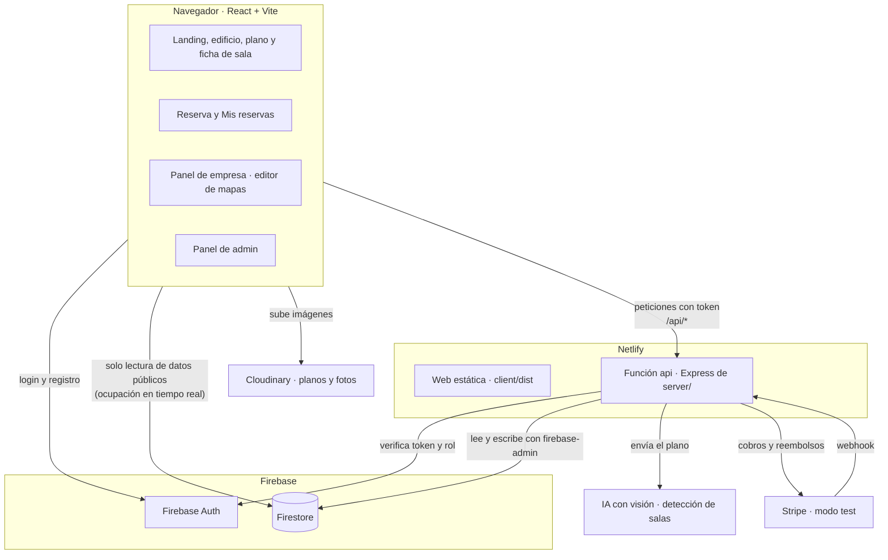
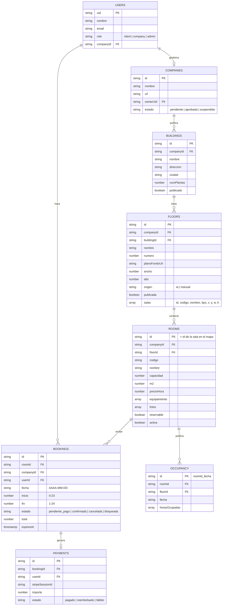
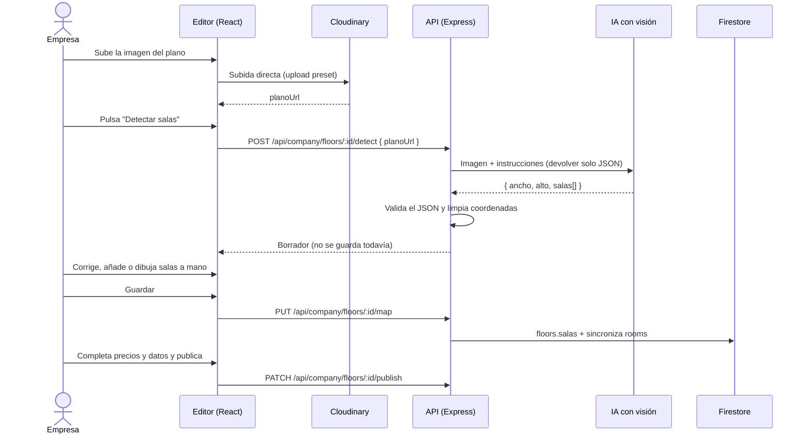
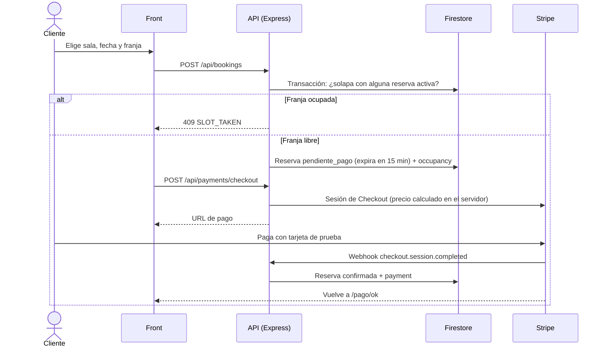

# Arquitectura de iPuente

Este documento explica cómo está organizado iPuente: qué piezas tiene, dónde va cada archivo, cómo se nombran las cosas y cómo trabajamos con Git. El qué hace la aplicación (funcionalidades, roles e historias de usuario) está en el [README](../README.md).

## Índice

- [Diagnóstico](#diagnóstico)
- [Visión general](#visión-general)
- [Stack](#stack)
- [Estructura de carpetas](#estructura-de-carpetas)
- [Capas del backend](#capas-del-backend)
- [Frontend](#frontend)
- [Modelo de datos](#modelo-de-datos)
- [Autenticación y roles](#autenticación-y-roles)
- [Flujo: del plano al mapa](#flujo-del-plano-al-mapa)
- [Flujo: reserva y pago](#flujo-reserva-y-pago)
- [Seguridad](#seguridad)
- [Variables de entorno](#variables-de-entorno)
- [Scripts](#scripts)
- [Convenciones](#convenciones)
- [Flujo de trabajo con Git](#flujo-de-trabajo-con-git)
- [Despliegue](#despliegue)
- [Riesgos](#riesgos)

## Diagnóstico

- **Tipo de proyecto:** fullstack en un solo repositorio, con un frontend (`client/`) y un backend (`server/`) gestionados con npm workspaces.
- **Stack:** React + Vite en el front; Express en el back; Firebase (Auth + Firestore) para usuarios y datos; Stripe en modo test; un modelo de IA con visión para detectar las salas en los planos; despliegue en Netlify.
- **Desviación del estándar:** el backend es un Express normal con su estructura por capas, pero en producción no corre en un servidor sino como **una única Netlify Function** que lo envuelve con `serverless-http`. En local se arranca con `node` como cualquier API.
- **Punto crítico:** el editor de mapas. Todo depende de él (plano para clientes, salas, 3D), así que es lo primero que se construye.

## Visión general



**Regla principal:** el navegador solo **lee** datos públicos de Firestore. Toda **escritura** (empresas, mapas, salas, reservas, pagos y roles) pasa por la API, que comprueba quién es el usuario y qué puede hacer.

## Stack

| Capa | Tecnología | Para qué |
| --- | --- | --- |
| Front | React 18, React Router 6, Vite 5 | Interfaz y navegación |
| Estilos | Una hoja de estilos propia, `client/styles/style.css`, con variables en `:root` | Requisito del bootcamp; sin frameworks de CSS |
| Validación | `express-validator` | Reglas por endpoint en `validators/` |
| Documentación API | Swagger: `swagger-jsdoc` + `swagger-ui-express` | Comentarios `@openapi` en las rutas, servidos en `/api/docs` |
| Límites | `express-rate-limit` | Protege la API y la detección con IA |
| Planos y editor | SVG + React | Plano clicable y editor de salas |
| Edificio | Imagen con zonas clicables → Three.js (extra) | Landing y página de edificio |
| Auth | Firebase Authentication (email y Google) | Registro, login, tokens y roles |
| Base de datos | Cloud Firestore | Todos los datos de la aplicación |
| Backend | Node 20+, Express 4, `firebase-admin` | API por capas |
| Ejecución del backend | Netlify Functions + `serverless-http` | Sin servidor que mantener |
| IA | API de Anthropic (Claude, modelo con visión) | Detectar salas en la imagen del plano |
| Pagos | Stripe Checkout en modo test | Cobro de reservas |
| Imágenes | Cloudinary (subida directa con *upload preset* sin firmar) | Planos y fotos de salas |
| Calidad | ESLint, Prettier, `node:test` | Estilo común y tests |

## Estructura de carpetas

La estructura completa, con la explicación de cada archivo, está en el [README](../README.md#estructura-del-proyecto). Resumen:

```text
ipuente/
├── client/                 # FRONT
│   ├── index.html          # única página HTML
│   ├── styles/style.css    # única hoja de estilos
│   ├── public/             # archivos estáticos
│   └── src/                # React: config, router, context, hooks, services, components, pages, utils
├── server/                 # API
│   ├── src/
│   │   ├── config/         # config.js (entorno + base de datos), swagger.js, stripe.js, ai.js
│   │   ├── routes/         # endpoints + comentarios @openapi
│   │   ├── validators/     # reglas de express-validator por endpoint
│   │   ├── middlewares/    # auth, requireRole, validate, rateLimit, errorHandler
│   │   ├── controllers/    # req/res
│   │   ├── services/       # lógica de negocio
│   │   ├── models/         # acceso a Firestore
│   │   ├── utils/
│   │   ├── app.js          # configura Express
│   │   └── server.js       # arranque en local
│   ├── tests/              # unit/ e integration/
│   └── scripts/            # makeAdmin, seed y datos de demo
├── netlify/functions/      # la API como Netlify Function
├── docs/                   # arquitectura y decisiones
└── .claude/                # configuración y agentes de Claude Code
```

## Capas del backend

```text
petición → routes → middlewares (auth, rol) → validators → validate → controllers → services → models → Firestore
```

| Capa | Responsabilidad | Nunca hace |
| --- | --- | --- |
| `routes/` | Define método, ruta, middlewares y validator, y documenta el endpoint con `@openapi` | Lógica |
| `validators/` | Reglas de `express-validator` del body, params y query de cada endpoint | Consultar la base de datos |
| `middlewares/` | Token (`auth`), rol (`requireRole`), resultado de la validación (`validate`), límites de peticiones (`rateLimit`), errores | Acceder a datos de negocio |
| `controllers/` | Lee `req`, llama al service y responde con `res` | Hablar con Firestore |
| `services/` | Reglas de negocio: solapes, precios, Stripe, IA, propiedad de los recursos | Tocar `req` o `res` |
| `models/` | Leer y escribir una colección de Firestore | Reglas de negocio |

Los errores se lanzan con `new HttpError(status, code, message)` y `errorHandler` los devuelve siempre así:

```json
{ "error": { "code": "VALIDATION_ERROR", "message": "Revisa los datos enviados", "details": [{ "campo": "fin", "mensaje": "La hora de fin debe ser posterior a la de inicio" }] } }
```

**Archivos por recurso:**

| Recurso | Ruta | Validator | Controlador | Service | Model |
| --- | --- | --- | --- | --- | --- |
| Edificios | `buildings.routes.js` | `commonValidator.js` | `buildingsController.js` | `companyService.js` | `buildingModel.js` |
| Plantas y mapas | `floors.routes.js`, `company.routes.js` | `mapValidator.js` | `floorsController.js`, `mapsController.js` | `mapsService.js`, `mapDetectionService.js` | `floorModel.js` |
| Salas | `rooms.routes.js` | `commonValidator.js` | `roomsController.js` | `availabilityService.js` | `roomModel.js`, `occupancyModel.js` |
| Reservas | `bookings.routes.js` | `bookingValidator.js` | `bookingsController.js` | `bookingsService.js`, `availabilityService.js` | `bookingModel.js` |
| Pagos | `payments.routes.js`, `webhook.routes.js` | `bookingValidator.js` | `paymentsController.js` | `paymentsService.js` | `paymentModel.js` |
| Usuarios | `users.routes.js` | `userValidator.js` | `usersController.js` | `usersService.js` | `userModel.js` |
| Empresa | `company.routes.js` | `companyValidator.js` | `companyController.js` | `companyService.js` | `companyModel.js` |
| Admin | `admin.routes.js` | `adminValidator.js` | `adminController.js` | `adminService.js` | todos |

**Documentación de la API:** cada ruta lleva encima un comentario `@openapi`. `config/swagger.js` los lee con `swagger-jsdoc` y `swagger-ui-express` los muestra en **`/api/docs`**, donde se pueden probar los endpoints con el token de Firebase (botón *Authorize*).

## Frontend

| Ruta | Página | Acceso |
| --- | --- | --- |
| `/` | `Landing` | Público |
| `/edificio/:buildingId` | `Building` | Público |
| `/planta/:floorId` | `Floor` | Público |
| `/sala/:roomId` | `Room` | Público (reservar exige sesión) |
| `/login`, `/registro` | `Login`, `Register` | Público |
| `/mis-reservas` | `MyBookings` | Cliente |
| `/pago/:resultado` | `PaymentResult` | Cliente |
| `/empresa` | `CompanyDashboard` | Empresa |
| `/empresa/edificios` | `CompanyBuildings` | Empresa |
| `/empresa/plantas/:floorId/editor` | `MapEditorPage` | Empresa |
| `/empresa/salas`, `/empresa/reservas` | `CompanyRooms`, `CompanyBookings` | Empresa |
| `/admin`, `/admin/empresas`, `/admin/usuarios`, `/admin/reservas`, `/admin/pagos` | `Admin*` | Admin |

- `PrivateRoute` y `RoleRoute` solo ocultan pantallas; la seguridad real está en la API y en `firestore.rules`.
- Todas las llamadas a la API pasan por `services/apiClient.js`, que añade el token y normaliza los errores. Los componentes nunca usan `fetch` directamente.
- `FloorPlan` (cliente) y `MapEditor` (empresa) leen el **mismo JSON** de planta: uno lo pinta y el otro lo edita.

## Modelo de datos



- **El mapa vive en `floors.salas`:** forma y posición de cada sala, en píxeles respecto a la imagen del plano. Se guarda y se lee de una vez.
- **Los datos comerciales viven en `rooms`:** precio, capacidad, equipamiento y fotos. El `id` de cada documento de `rooms` es el mismo que el de su sala en el mapa. Al guardar un mapa, `mapsService` crea las salas nuevas en `rooms` y desactiva las que se han borrado.
- **`companyId` se repite** en plantas, salas y reservas a propósito: así las reglas de Firestore y la API comprueban la propiedad sin consultas extra.
- **`occupancy`** guarda solo las horas ocupadas de cada sala y día, sin nombres ni importes. El plano la escucha en tiempo real y las reservas siguen siendo privadas.

## Autenticación y roles

1. Login y registro con Firebase Auth en el navegador. Todo usuario nuevo es `client`.
2. Una empresa se da de alta con `POST /api/company/register` y queda en estado `pendiente`.
3. Un admin la aprueba y la API asigna al dueño los *custom claims* `{ role: 'company', companyId }`.
4. El front obtiene el token con `getIdToken()` y `apiClient` lo envía en cada petición.
5. `middlewares/auth.js` lo verifica con `verifyIdToken()` y deja `req.user = { uid, role, companyId }`. `requireRole()` filtra por rol, y los services comprueban que el recurso pertenece a `req.user.companyId`.
6. El primer admin se crea con `npm run make-admin -w server -- correo@ejemplo.com`.

Tras cambiar un claim, el usuario debe refrescar el token (cerrar sesión o `getIdToken(true)`).

## Flujo: del plano al mapa



- La detección solo devuelve un **borrador**: nada se guarda hasta que la empresa pulsa Guardar.
- Si la IA falla o tarda demasiado, la API responde `502 AI_DETECTION_FAILED` y el editor sigue disponible para dibujar a mano.
- Las coordenadas se guardan en píxeles de la imagen original; el SVG usa `viewBox="0 0 ancho alto"`, así el mapa escala solo.

## Flujo: reserva y pago



- **Solape:** `nuevaInicio < existenteFin && nuevaFin > existenteInicio`, contando reservas `confirmada`, `bloqueada` y `pendiente_pago` sin caducar.
- **Caducidad:** una reserva sin pagar en 15 minutos deja de bloquear la franja; `availabilityService` la marca como `cancelada` la próxima vez que consulta esa sala.
- **Cancelación por el cliente:** hasta 24 h antes; si estaba pagada, se pide el reembolso a Stripe.

## Seguridad

- Contraseñas: las gestiona Firebase Auth. Datos de tarjeta: los gestiona Stripe. Ninguno pasa por nuestro código.
- El precio se calcula siempre en el servidor.
- El webhook de Stripe verifica la firma; por eso se monta con `express.raw()` antes de `express.json()` en `app.js`.
- Las claves de Firebase Admin, Stripe y la IA solo existen como variables de entorno del servidor.
- `firestore.rules` bloquea toda escritura desde el navegador y limita la lectura: lo publicado es público, cada empresa ve lo suyo y cada cliente sus reservas. `firebase-admin` ignora estas reglas, por eso la API sí puede escribir.
- `.gitignore` excluye `.env` y cualquier `*serviceAccount*.json` desde el primer commit.

## Variables de entorno

| Variable | Archivo | Pública | Para qué |
| --- | --- | --- | --- |
| `VITE_FIREBASE_API_KEY`, `VITE_FIREBASE_AUTH_DOMAIN`, `VITE_FIREBASE_PROJECT_ID`, `VITE_FIREBASE_APP_ID` | `client/.env` | Sí | SDK de Firebase en el navegador |
| `VITE_CLOUDINARY_CLOUD_NAME`, `VITE_CLOUDINARY_UPLOAD_PRESET` | `client/.env` | Sí | Subida de planos y fotos |
| `VITE_API_URL` | `client/.env` | Sí | Base de la API (`/api`) |
| `FIREBASE_PROJECT_ID`, `FIREBASE_CLIENT_EMAIL`, `FIREBASE_PRIVATE_KEY` | `server/.env` | No | Firebase Admin |
| `STRIPE_SECRET_KEY`, `STRIPE_WEBHOOK_SECRET` | `server/.env` | No | Pagos |
| `ANTHROPIC_API_KEY`, `AI_MODEL` | `server/.env` | No | Detección de salas |
| `APP_URL` | `server/.env` | No | URLs de vuelta de Stripe |
| `PORT` | `server/.env` | No | Puerto en local |

Todo lo que empieza por `VITE_` acaba en el navegador: nunca debe contener secretos. En Netlify, todas se configuran en *Site configuration → Environment variables*.

## Scripts

| Comando (desde la raíz) | Qué hace |
| --- | --- |
| `npm install` | Instala client y server (workspaces) |
| `npm run dev` | `netlify dev`: Vite + API juntos en `http://localhost:8888` |
| `npm run dev:client` / `npm run dev:server` | Solo front (`:5173`) o solo API (`:3000`) |
| `npm run build` | Build del front en `client/dist` |
| `npm run lint` | ESLint en client y server |
| `npm test` | Tests del server con `node:test` |
| `npm run format` | Prettier en todo el proyecto |
| `npm run seed -w server` | Datos de demo |
| `npm run make-admin -w server -- correo@ejemplo.com` | Da rol admin a un usuario |

## Convenciones

| Qué | Convención | Ejemplo |
| --- | --- | --- |
| Componentes React | `PascalCase.jsx` | `RoomCard.jsx` |
| Hooks | `useCamelCase.js` | `useMapEditor.js` |
| Resto de archivos JS | `camelCase.js` | `bookingsService.js`, `httpError.js` |
| Rutas de Express | `recurso.routes.js` | `bookings.routes.js` |
| Carpetas | `kebab-case` | `map-editor/`, `floor-plan/` |
| Variables de entorno | `MAYUSCULAS_CON_GUIONES` | `STRIPE_SECRET_KEY` |
| Campos de Firestore | `camelCase`, en español como en el dominio | `precioHora`, `planoFondoUrl` |
| Códigos de error | `MAYUSCULAS_CON_GUIONES` | `SLOT_TAKEN`, `FORBIDDEN` |
| Imports en el front | Alias `@/` | `import Button from '@/components/ui/Button.jsx'` |
| CSS | Todo en `client/styles/style.css`, por secciones; variables en `:root`; media queries y keyframes al final | — |
| Validators | `recursoValidator.js`, un export por endpoint | `bookingValidator.create` |

## Flujo de trabajo con Git

- **`main`** siempre desplegable y protegida: nadie hace push directo.
- **Una rama por historia de usuario o tarea:** `feature/hu-08-deteccion-ia`, `fix/solape-reservas`, `docs/api`, `chore/eslint`.
- **Commits con Conventional Commits:** `feat: editor de mapas con arrastre`, `fix: solape al cancelar`, `docs: endpoints de empresa`. Un cambio estructural es un commit aparte, nunca mezclado con lógica.
- **Pull Request** revisada por otra persona del equipo antes de fusionar. Netlify genera una *deploy preview* de cada PR para probarla.
- **Decisiones** nuevas de arquitectura, en [`docs/decisiones.md`](./decisiones.md).
- **Archivos que sobran:** se mueven a `_to_delete/` y se avisa al equipo; no se borran por cuenta propia.

## Despliegue

- **Netlify** construye `client/` y publica `client/dist`. La carpeta `netlify/functions/` contiene la función `api`, que importa `server/src/app.js`.
- **Redirecciones** (`netlify.toml`): `/api/*` va a la función y cualquier otra ruta, a `index.html` (React Router).
- **Firestore:** reglas e índices con `firebase deploy --only firestore` (requiere `firebase-tools`).
- **Webhook de Stripe en local:** `stripe listen --forward-to localhost:8888/api/payments/webhook`.
- **Cloudinary:** crear un *upload preset* sin firmar llamado `ipuente_planos`, limitado a imágenes.

## Riesgos

| Riesgo | Mitigación |
| --- | --- |
| El editor de mapas se retrasa y bloquea el resto | Se empieza el primer día; el plano del cliente se prueba con un JSON de ejemplo mientras tanto |
| La IA detecta mal un plano | Solo genera un borrador editable; el editor manual siempre está disponible; para la demo se preparan planos probados |
| Coste o límite de la API de IA | Límite de gasto en la cuenta; solo empresas aprobadas pueden llamar a `/detect`, con un máximo de 10 análisis por hora (`aiLimiter`) |
| Límite de 6 MB por petición en Netlify Functions | Las imágenes van directas del navegador a Cloudinary; la API solo recibe la URL |
| Arranque en frío de la función | Asumible en un proyecto de clase; el plano lee la ocupación directamente de Firestore |
| Alguien sube el `.env` | En `.gitignore` desde el primer commit; solo se versiona `.env.example` |
| `FIREBASE_PRIVATE_KEY` pierde los saltos de línea en Netlify | `config/config.js` hace `.replace(/\\n/g, '\n')` |
| Conflictos entre 4 personas | Ramas por tarea, PR revisadas y carpetas separadas por funcionalidad |
